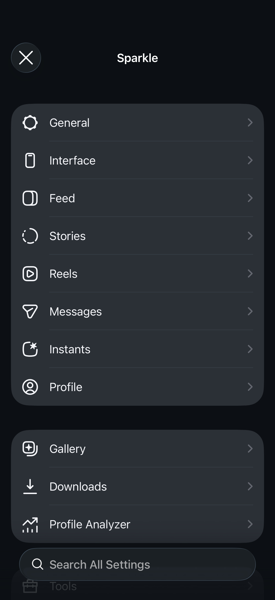
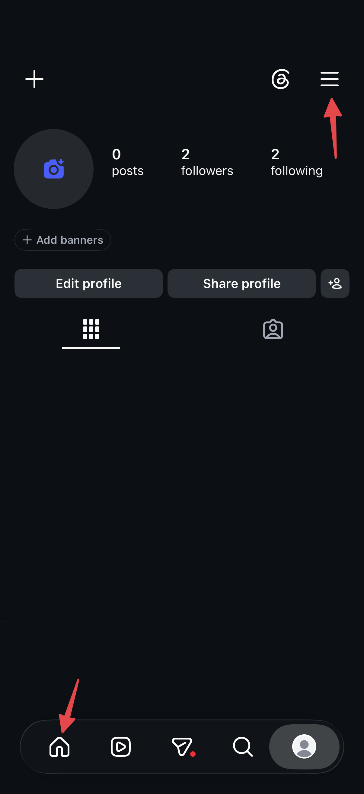

<div align="center">

 

# PhoenixGram for Instagram

`v1.2.0` · Tested on versions **441.0.0** and **410.1.0**

</div>

---

> [!NOTE]
> - PhoenixGram is an open-source enhancement tweak for iOS Instagram based on [Sparkle](https://github.com/efibalogh/sparkle-ig) by [efibalogh](https://github.com/efibalogh).
> - To open PhoenixGram's settings, see [Opening PhoenixGram Settings](#opening-phoenixgram-settings).

## What is PhoenixGram?

PhoenixGram is a [Theos](https://theos.dev) tweak that reshapes the iOS Instagram app around you. Download any media, keep a private on-device gallery, recover deleted messages, run each account with its own settings, analyze your followers, and strip out the ads, AI, and annoyances.

It is based on the open-source Sparkle project by efibalogh (which originated from SoCuul's SCInsta).

- Targets **iOS 15.0+**, built with the iOS 16.2 SDK.
- Works **jailbroken** (tested via Dopamine on iOS 16.7.16) and **sideloaded** (Feather, SideStore, LiveContainer etc.).
- Written in Objective-C / Objective-C++ / Logos.

## Highlights

For the full list of features, check out [`FEATURES.md`](FEATURES.md).

- **Media downloads**:
  - Save feed posts, reels, stories, DMs, Instants, and comments.
  - Auto-save stories, view-once DM media, and instants straight to the Gallery or Photos as you view them.
  - An action-based download manager with a queue, retries, duplicate detection, and configurable concurrency.
  - High-quality DASH video+audio merging via FFmpegKit.
- **Private Gallery**:
  - An on-device media library with folders, search, metadata, source overlays, and an optional passcode / Face ID / Touch ID lock. Nothing ever leaves your device.
  - Import your own media from Files with editable metadata, or bring your whole Regram Media Vault over in one go.
  - Browse saved Instants by user straight from the Instants camera.
  - Send any photo or video you already have as an Instant, from Photos, Files, or the Gallery.
- **Built-in editors**:
  - Trim any video down to a clip, a single still frame, or audio-only.
  - Crop, pan/zoom, rotate, and flip a video's framing, applied in the same pass as the trim.
  - A photo editor with crop / pan-zoom / rotate / flip.
  - Reachable from the gallery, media preview, or an opt-in action button.
- **Action buttons everywhere**:
  - Fully customizable action-button menus on feed, reels, stories, DMs, Instants, and profiles.
  - Reorder, rename, re-icon, and set per-surface default tap actions.
  - An optional feed-header shortcut button for one-tap access to Gallery, Profile Analyzer, Deleted Messages, Downloads or Settings.
- **Keep deleted messages**:
  - Preserve unsent DMs, log removed reactions, and recover view-once media, with a browsable log.
- **Profile Analyzer**:
  - Fetches your followers/following and surfaces mutuals, non-followbacks, and a durable change log (new/lost followers, profile updates) across scans.
- **Per-account settings**:
  - Each logged-in account keeps its own preferences, gallery scope, and download history.
- **Privacy & focus**:
  - Hide ads, Meta AI, and suggested content.
  - Disable seen receipts, typing status, screenshot detection, and view-once limits.
  - Block doom-scrolling.
  - Hide tabs and UI clutter.
- **Confirmations**:
  - Optional "are you sure?" guards for accidental likes, follows, reposts, calls, comments, and more.
- **Profile follow-status badge**:
  - Live status badge right on user profiles indicating whether they follow you back: `Follows you 😊` (green) or `Doesn't follow you 😔` (red).
  - Cleanly hides when unknown or on your own profile.
  - Fully customizable in Settings (Text, Icon, or Icon + Text, with vibrant colors or native gray).
- **Liquid Glass (iOS 26+)**:
  - Native Liquid Glass integration across PhoenixGram's own UI, plus an option to force-enable Instagram's.
  - On iOS 18 and lower, a **Pill-Shaped Tab Bar** toggle brings the floating pill tab bar (shape only; the glass material stays iOS 26+).

## Installation

PhoenixGram is distributed as:
- **Standalone injection-ready tweak `.dylib`** (`Sparkle.dylib` / `PhoenixGram.dylib`), compiled automatically via GitHub Actions for sideloading into an Instagram IPA.
- **Rootless `.deb`** (`iphoneos-arm64`) for modern jailbreaks (Dopamine, palera1n rootless).
- **Rootful `.deb`** (`iphoneos-arm`) for legacy rootful jailbreaks.

### GitHub Actions Automated Builds

Every push and pull request on `main`, `phoenixgram`, and `dev` triggers the **Build PhoenixGram** workflow:
1. Navigate to the **Actions** tab in this repository.
2. Select the latest run of the **Build PhoenixGram** workflow.
3. Under **Artifacts**, download:
   - `PhoenixGram-v<version>-sideload-dylibs`: Contains the standalone injection-ready `Sparkle.dylib` (and `PhoenixGram.dylib`), companion `SPKSideloadFix.dylib`, `libFLEX.dylib`, and filter plists.
   - `PhoenixGram-v<version>-deb-packages`: Contains the rootless and rootful `.deb` packages for jailbroken devices.

---

## IPA Injection & Sideloading Guide

To run PhoenixGram on non-jailbroken devices via sideloading (AltStore, SideStore, Feather, LiveContainer, Sideloadly):

### 1. Requirements
- **Decrypted Instagram IPA**: Obtain a decrypted, un-thinned IPA of a supported Instagram version (tested on **441.0.0** and **410.1.0**).
- **PhoenixGram Sideload Dylibs**: Downloaded from GitHub Actions artifacts (`Sparkle.dylib` and companion `SPKSideloadFix.dylib`).
- **Signing Certificate / Profile**: A free 7-day Apple ID, developer account certificate, or an enterprise cert.

### 2. Required Files for Injection
- `Sparkle.dylib` (or `PhoenixGram.dylib`): The main compiled tweak binary (arm64, iOS 15.0+).
- `SPKSideloadFix.dylib`: **Mandatory companion dylib** that patches sideload sandbox paths, keychain access, and prevents crash loops on sideloaded installations.
- `CydiaSubstrate` / `Substitute`: Runtime hooking engine provided by injection tools (e.g. `cyan`, `Azule`, or `Sideloadly`).
- `modules/ffmpegkit/*.framework` (Optional): Required if you plan to use in-app DASH video+audio merging and local media editing.

### 3. Recommended Injection Methods

#### Option A: cyan / pyzule (macOS / Linux / Windows CLI)
```sh
cyan -i com.burbn.instagram.ipa -o PhoenixGram.ipa -f Sparkle.dylib SPKSideloadFix.dylib -m 15.0 -duq
```
*(If building for SideStore/AltStore, pass `--no-ext` / remove `.appex` extension bundles to avoid exceeding app ID limits).*

#### Option B: Azule (macOS / Linux CLI)
```sh
azule -i com.burbn.instagram.ipa -o PhoenixGram.ipa -f Sparkle.dylib SPKSideloadFix.dylib
```

#### Option C: Sideloadly (GUI for macOS & Windows)
1. Open **Sideloadly** and drag your decrypted Instagram IPA into the app.
2. Click **Advanced Options**.
3. Under **Tweak Injection**, click `+` and select both `Sparkle.dylib` and `SPKSideloadFix.dylib`.
4. Ensure CydiaSubstrate injection is enabled.
5. Enter your Apple ID and click **Start** to inject, sign, and sideload to your device.

#### Option D: On-Device Signing (Feather / SideStore / Scarlet / Esign)
1. Import the decrypted Instagram IPA into your signing app.
2. In the tweak/dylib management settings for the app, add `Sparkle.dylib` and `SPKSideloadFix.dylib`.
3. Sign with your provisioning profile and install.

---

## Opening PhoenixGram Settings

By default, **long-press the Home tab** or the **Profile settings button** to open PhoenixGram Settings. You can also enable *Show Settings on App Launch*. If you hide the Home tab, the long-press automatically moves to another visible tab so Settings is always reachable.

## Screenshots

| Settings | How to Access |
|:-------------:|:------------:|
|  |  |

## Building from source

### Prerequisites

- **Xcode** + Command-Line Developer Tools
- [Homebrew](https://brew.sh)
- [Theos](https://theos.dev/docs/installation) with the **iPhoneOS16.2.sdk** in `~/theos/sdks`
- `brew install ldid dpkg make cmake` (plus the FFmpeg build deps: `autoconf automake libtool meson nasm ninja pkgconf wget yasm`)
- **For sideloading only:** [cyan](https://github.com/asdfzxcvbn/pyzule-rw#install-instructions) and [ipapatch](https://github.com/asdfzxcvbn/ipapatch/releases/latest)

### Setup

1. **Install the iOS 16.2 SDK** for Theos — download from [xybp888/iOS-SDKs](https://github.com/xybp888/iOS-SDKs) and copy `iPhoneOS16.2.sdk` into `~/theos/sdks`.
2. **Clone with submodules:**
   ```sh
   git clone --recurse-submodules https://github.com/efibalogh/sparkle-ig
   cd sparkle-ig
   ```
3. **Fetch the FFmpegKit frameworks** (used for video/audio merging & trimming):
   ```sh
   ./fetch-ffmpegkit.sh
   ```
4. **For sideloading:** obtain a **decrypted, un-thinned** Instagram IPA from a trusted source, rename it to `com.burbn.instagram.ipa`, and place it in a `packages/` folder at the repo root.

> [!IMPORTANT]
> Use a *universal* decrypted IPA. An IPA that was already thinned to a specific device (e.g. dumped on an older iPhone) might be missing higher-scale icons/image assets, which makes icons and image assets blurry on newer devices.
>
> Alternatively, if you own a jailbroken device, I recommend using [ipadecrypt](https://github.com/londek/ipadecrypt), which provides an un-thinned IPA regardless of your device's screen size.

### Build

```sh
./build.sh rootless          # rootless .deb (jailbroken)
./build.sh rootful           # rootful .deb (jailbroken)
./build.sh ipa --release     # sideload IPA (= --inject --ffmpeg --patch)
```

The `ipa` command takes composable flags:

| Flag | Effect |
|------|--------|
| `--release` | Shorthand for `--inject --ffmpeg --patch` |
| `--inject` | Inject `Sparkle.dylib` |
| `--ffmpeg` | Bundle the FFmpegKit frameworks |
| `--flex` | Bundle `libFLEX.dylib` (in-app debugging) |
| `--patch` | Run `ipapatch` |
| `--no-ext` | Strip all `.appex` bundles before injection |
| `--sidestore` | Shorthand for `--release --no-ext` (for SideStore) |
| `--dev` | `DEV=1` build (also enables the developer diagnostics: performance meter and hook bisect, under Settings → Tools → Diagnostics) |
| `--buildonly` | Build dylibs only, skip IPA packaging |
| `--bundle-id <id>` | Override the bundle ID |

Outputs are named with the Sparkle version (and, for IPAs, the bundled Instagram version) so builds are easy to tell apart:

- **IPA**: `Sparkle[_<flags>]_v<version>_IG_v<ig version>.ipa` (e.g. `Sparkle_v1.0.0_IG_v437.2.0.ipa`, or `Sparkle_no-flex_v1.0.0_IG_v437.2.0.ipa`)
- **deb**: `Sparkle_v<version>_<rootless|rootful>.deb`

Run `./build.sh` with no arguments for the full usage reference.

### Recompiling the Liquid Glass app icons

The app icons are pre-compiled into `resources/sparkle_icons/` to keep IPA packaging fast. If you change the source `.icon` bundles in `resources/`, recompile them with `actool` before building:

```zsh
mkdir -p resources/compiled_sparkle resources/compiled_sparkle_dark resources/compiled_sparkle_neutral

xcrun actool resources/sparkle.icon         --compile resources/compiled_sparkle         --platform iphoneos --minimum-deployment-target 15.0 --app-icon sparkle         --output-partial-info-plist resources/sparkle_partial.plist         --target-device iphone --target-device ipad
xcrun actool resources/sparkle-dark.icon    --compile resources/compiled_sparkle_dark    --platform iphoneos --minimum-deployment-target 15.0 --app-icon sparkle-dark    --output-partial-info-plist resources/sparkle_dark_partial.plist    --target-device iphone --target-device ipad
xcrun actool resources/sparkle-neutral.icon --compile resources/compiled_sparkle_neutral --platform iphoneos --minimum-deployment-target 15.0 --app-icon sparkle-neutral --output-partial-info-plist resources/sparkle_neutral_partial.plist --target-device iphone --target-device ipad

mkdir -p resources/sparkle_icons
cp resources/compiled_sparkle/*.png resources/compiled_sparkle_dark/*.png resources/compiled_sparkle_neutral/*.png resources/sparkle_icons/
rm -rf resources/compiled_sparkle resources/compiled_sparkle_dark resources/compiled_sparkle_neutral resources/*_partial.plist
```

## Contributing

Contributions are greatly appreciated! Feel free to open a pull request.

- New hooked IG classes/methods go in `src/InstagramHeaders.h`
- Prefix all custom symbols with `spk_` / `SPK`.
- Break new features into `src/Features/<Surface>/` rather than bloating `Tweak.x`.

Not a coder? Documentation improvements are always appreciated too.

## Author & Maintainer

- **Namish Yadav** ([p3xz](https://github.com/p3xz)) — Creator & maintainer of PhoenixGram.

## Credits & Upstream

- [**waffle (efibalogh)** • Sparkle](https://github.com/efibalogh/sparkle-ig): the upstream project PhoenixGram is based on.
- [**SoCuul** • SCInsta](https://github.com/SoCuul/SCInsta): the base project Sparkle was built on.
- [**BandarHL** • BHInstagram](https://github.com/BandarHL/BHInstagram): the original tweak SCInsta forked from.
- [**Ryuk** • RyukGram](https://github.com/faroukbmiled): code, inspiration, and help.
- [**@n3d1117** • InstaSane](https://github.com/n3d1117/InstaSane): the Following-feed mode.
- [**@asdfzxcvbn** • zxPluginsInject / ipapatch / cyan](https://github.com/asdfzxcvbn): tooling and fixes for sideloaded installs.
- [**@BillyCurtis** • OpenInstagramSafariExtension](https://github.com/BillyCurtis/OpenInstagramSafariExtension): open Instagram links in Safari in the sideloaded IPA.

## License

PhoenixGram is licensed under the [GNU General Public License v3.0](LICENSE).
Original Sparkle codebase copyright © efibalogh and contributors.
